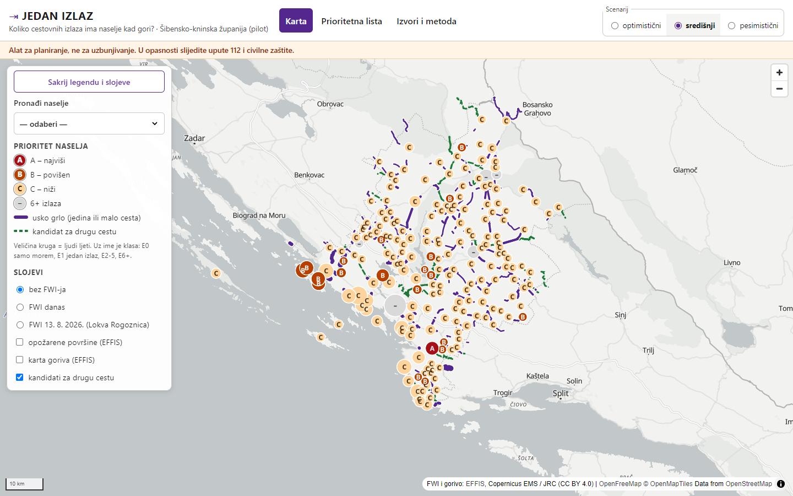

# JEDAN IZLAZ

**Koliko cestovnih izlaza ima vaše naselje kad gori?** Javna web karta za planiranje evakuacije: za svako
naselje broj neovisnih cestovnih izlaza do sigurne mreže, usko grlo i broj ljudi ljeti iza njega, vrijeme
evakuacije cestom kao raspon scenarija te opasnost od požara (statička i dnevna EFFIS FWI). Iz toga nastaje
prioritetna lista naselja kojima treba plan evakuacije (i morem) i kandidati za „drugu cestu“.

Pilot: **Šibensko-kninska županija** (199 naselja). *Datathon Portala otvorenih podataka 2026.*, izazov B –
Okoliš i održivi prostor.

> Alat za planiranje, ne za uzbunjivanje. U opasnosti slijedite upute 112 i civilne zaštite.

**Demo:** https://dlukas99.github.io/jedan-izlaz/



## Što pokazuje (ŠKŽ, stanje 29. 10. 2026.)

- **45 naselja ima samo jedan cestovni izlaz (E1)** — u njima je ljeti 40–56 tisuća ljudi; **9 naselja nema vozivu
  cestu do kopna** (Zlarin, Prvić Luka, Prvić Šepurine, Krapanj, Kaprije, Žirje …).
- Otok Murter (Murter, Betina, Jezera) i Tisno: jedan izlaz preko D121 i pokretnog mosta u Tisnu, ljeti 21–30 tisuća
  ljudi iza njega, evakuacija cestom 5–25 h. Izmjereni ljetni promet (HC, brojilo Murter): 5.835 vozila/dan.
- Na dan požara kod Lokve Rogoznice (13. 8. 2026.) 174 od 199 naselja bilo je u razredu „ekstreman“ ili
  „vrlo ekstreman“ EFFIS FWI-ja.

Brojke: [`web/public/data/kpi.json`](web/public/data/kpi.json). Metoda: [docs/metodologija.md](docs/metodologija.md).

## Pokretanje u 3 naredbe

```powershell
python -m venv .venv; .\.venv\Scripts\Activate.ps1; pip install -r etl/requirements.txt
python -m etl.pipeline --county SKZ --mode live
cd web; npm install; npm run dev
```

- Testovi: `pytest -q` · provjera izvora: `python -m etl.probe` → [docs/probe_report.md](docs/probe_report.md)
- Model podložnosti (D11): `python -m etl.ml_susceptibility` → [docs/evaluacija.md](docs/evaluacija.md)
- Analiza osjetljivosti: `python -m etl.osjetljivost` → [docs/osjetljivost.md](docs/osjetljivost.md)
- Noćni FWI: `python -m etl.fwi_today` (GitHub Actions `nightly_fwi`)
- Prvo pokretanje preuzima DGU Upravne jedinice (~209 MB) i Geofabrik izvadak za Hrvatsku (~200 MB).

## Dokumentacija

| | |
|---|---|
| [arhitektura.md](docs/arhitektura.md) | arhitektura, standardi, integracija, tehnički/organizacijski/pravni preduvjeti |
| [metodologija.md](docs/metodologija.md) | D1–D12: graf, minimalni rez, ljetna populacija, vrijeme evakuacije, opasnost, prioritet, ograničenja |
| [izvori.md](docs/izvori.md) | svi skupovi podataka s izdavačem, poveznicom, licencom i datumom dohvata (generirano) |
| [evaluacija.md](docs/evaluacija.md) | evaluacija modela podložnosti požaru (prostorna blok-CV) |
| [kvaliteta_podataka.md](docs/kvaliteta_podataka.md) | spajanje, validacija, kontrole razumnosti (generirano) |
| [openapi.yaml](docs/openapi.yaml), [dcat-ap.jsonld](docs/dcat-ap.jsonld) | opis statičkih krajnjih točaka i izvedenog skupa |
| [video_scenarij.md](docs/video_scenarij.md), [predaja.md](docs/predaja.md) | video i kontrolna lista predaje |

## Izvori podataka (ukratko)

DZS (Popis 2021., stanovi za odmor, Turizam 2025.) i Hrvatske ceste (brojenje prometa 2025.) preko **data.gov.hr CKAN
API-ja**; DGU Upravne jedinice (ATOM) i Registar geografskih imena (WFS); Hrvatske ceste INSPIRE WFS; EFFIS FWI i
opožarene površine (WMS/WFS, uživo); ESA WorldCover 2021; OpenStreetMap (Geofabrik). Puni popis: [docs/izvori.md](docs/izvori.md).

## Licence

- Kod: **EUPL-1.2** ([LICENSE](LICENSE)).
- Izvedeni podaci s geometrijom iz OpenStreetMapa: **ODbL 1.0** („© OpenStreetMap contributors“).
- Sadrži podatke Državne geodetske uprave. EFFIS i ESA WorldCover: CC BY 4.0. DZS i HC: Otvorena dozvola.

## Korišteni AI alati

U razvoju je korišten **Claude Code** (Anthropic) kao pomoćnik za pisanje koda i dokumentacije; tim je pregledao
i provjerio rezultate. Samo rješenje ne koristi nikakve zatvorene AI API-je (model D11 je scikit-learn, lokalno).
